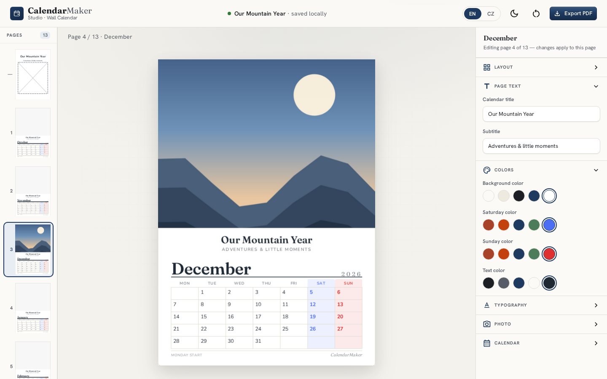
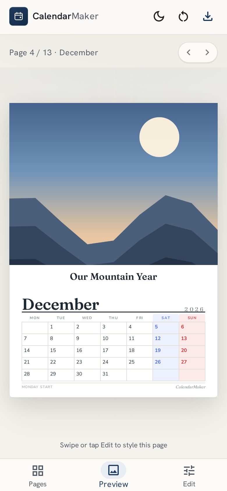
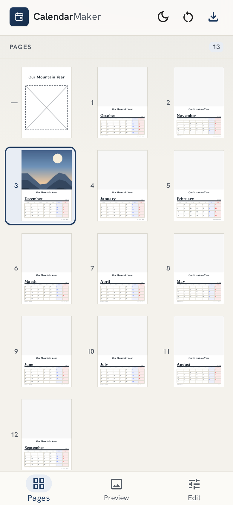

# CalendarMaker

**Turn your own photos into a beautiful, print-ready wall calendar — right in your browser.**

CalendarMaker is a simple online tool for making a personal 13-page photo calendar: a cover plus one page
for every month. You drop in your favourite pictures, tweak the colours, fonts and layout until it feels
like *yours*, and download a print-ready PDF you can send to any print shop or printer at home.

Everything happens **in your browser** — there's no sign-up, no account, and your photos never leave your
device.

---

## The problem it solves

Shop-bought photo calendars usually mean one of two things: a clunky website that makes you create an
account and upload your private photos to someone else's server, or heavy professional design software
that's overkill for "I just want my holiday pictures on the wall."

CalendarMaker is the calm middle ground. It's **free, instant and private**:

- 🖼️ **Your photos, your calendar** — one picture per month, positioned and zoomed exactly how you like.
- 🎨 **Make it yours** — change page colours, weekend highlights, fonts and title text live as you edit.
- 🔒 **Totally private** — all your images and work stay on your own device; nothing is uploaded anywhere.
- 🖨️ **Print-ready** — export a single, high-quality A4 PDF of all 13 pages, ready for the printer.
- 🌍 **Two languages** — switch the whole calendar between **English** and **Czech** in one tap.

---

## How it works

1. **Add a photo** to any page and drag it around (or just drag an image straight from your computer onto
   the page).
2. **Style it** — pick a layout, set the title, choose colours and fonts. Weekends are highlighted
   automatically.
3. **Pick your starting month and year**, in English or Czech.
4. **Export** a print-ready PDF — and choose the quality/size that suits you.

Your calendar is saved automatically in the browser, so you can close the tab and pick up right where you
left off.

---

## Screenshots

### On the desktop

The full editor: your pages down the left, the live calendar page in the middle, and all the styling
controls on the right.



### On mobile

The same tool, rebuilt for phones. A bottom bar switches between **Pages**, **Preview** and **Edit**, so
everything stays within thumb's reach.

<p align="left">
  
  &nbsp;&nbsp;
  
</p>

---

## Highlights

- A real **what-you-see-is-what-you-print** editor — the page on screen is exactly what comes out in the PDF.
- Several **layout templates** for each month page.
- **Weekend colours**, custom fonts and font sizes, and per-page photo positioning.
- **Works on desktop and mobile**, light and dark mode.
- **No backend, no accounts, no tracking** — a genuinely private, offline-friendly tool.

---

## For the technically curious

CalendarMaker is a single-page web app with **no server** — it runs entirely in the browser.

| Area | Technology |
| --- | --- |
| Language | TypeScript |
| Framework / build | React + Vite |
| UI | Material UI, with a small set of custom controls |
| Canvas / rendering | react-konva (the live calendar pages) |
| PDF export | jsPDF |
| Local storage | IndexedDB (via Dexie) — your data stays on your device |
| Validation | Zod |
| Testing | Vitest + React Testing Library (unit/component), Playwright (end-to-end) |
| Languages | English + Czech (i18n) |

### Run it locally

```bash
npm install
npm run dev        # start the app in development
npm run test:run   # run the test suite
npm run build      # produce a production build
```

The build is a set of static files, so it can be hosted on any static web host.
