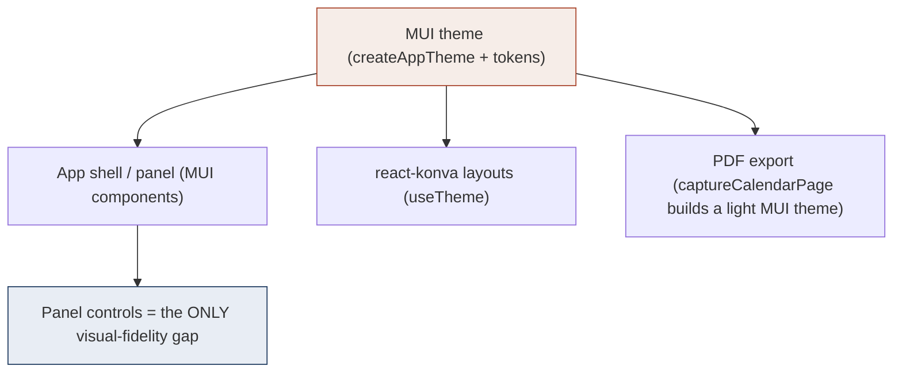

# Proposal: UI library for panel-level visual fidelity

> Status: **DRAFT for decision** · 2026-10-15 · Author: JirkaVrbka (with Claude)
> Trigger: the editor's right-panel controls (text inputs, selects, section-label icons) don't match the
> bespoke `mockups/app-professional.html` because Material UI (MUI) components carry Material styling.
> This is a cross-cutting change to the UI stack, so it needs a proposal before any code (see
> `docs/guidelines/design-proposals.md`) — and switching the stack needs explicit human approval per `CLAUDE.md`.

## Problem statement

The app looks like the mockup at the **structure** level (layout, sections, backgrounds, fonts, the calendar
page). The remaining gap is at the **control** level: MUI's `TextField` (floating label in a notched outline),
`Select` (Material menu), `Slider`, and the Material-ish icons don't match the mockup's lean controls —
`.textin` (a bordered `<input>` with the label *above*), `.select-wrap` (a native `<select>` + custom
chevron), thin line-icon section labels. You can't close this by tweaking props; MUI's label/notch model is a
different shape from the mockup's. The question: **restyle within MUI, build small custom controls, or switch
UI library for more control?**

## Current MUI footprint (measured)

- **31 / 87** source files import `@mui/*`.
- ~**20** distinct `@mui/material` components (Box, Stack, Typography, TextField, Select/MenuItem, Slider,
  Button/ButtonBase/IconButton, AppBar/Toolbar, Collapse, Divider, Tooltip, Snackbar/Alert, CssBaseline,
  CircularProgress, `styles`/`useMediaQuery`) + **16** icons.
- **0** direct `@emotion/styled` — styling is via `sx` + the custom **theme** (`createAppTheme` + `theme.tokens`).
- **The theme is load-bearing beyond chrome:** the react-konva layouts call `useTheme()`, and the **PDF export**
  (`src/features/export/captureCalendarPage.ts` → `createAppTheme('light')`) renders the calendar through the
  MUI theme. So the theme/token mechanism is wired into the **rendering and print pipeline**, not just the panel.

The red node (theme) is why a full switch is expensive: replacing MUI means replacing the thing the canvas and
the exporter depend on. The blue node (panel controls) is the actual problem, and it is small.

## Proposed solution (recommended)

**Do not switch libraries. Build a thin set of custom, token-driven panel primitives** and keep MUI everywhere
else. Specifically: a `Field` (label-above wrapper), `TextInput`, and `Select` (native `<select>` + chevron)
styled from `theme.tokens` to match `.textin` / `.select-wrap`, plus thin line-icon section labels. Swatches
and font-buttons are already custom. The MUI `Slider` either stays or is replaced by a styled `<input
type=range>` (cheap). This matches the mockup **exactly** for the ~4 control types that differ, with no change
to the shell, canvas, export, data model, or the 271 passing tests beyond the panel's own.

Why this over the other two: it targets the real gap, keeps the theme the canvas/export rely on, and stays
within the documented stack (hand-building these few bespoke controls is a small, justified exception to the
"prefer MUI" default — not a stack change).

## Alternatives considered

1. **Theme MUI harder (stay 100% MUI).** Override `MuiOutlinedInput` / `MuiInputLabel` / `MuiSelect` /
   `MuiSlider` via `styleOverrides`. No new components. But you fight the floating-label/notch model and MUI's
   markup; realistically ~90% match with lingering Material feel, and brittle overrides. *Cheaper than a switch,
   worse fidelity than custom primitives.*

2. **Switch UI library** to a headless stack (Radix UI / Headless UI primitives + Tailwind or plain CSS), or a
   Tailwind component kit (shadcn-style). Maximum styling control; likely a **smaller bundle** (MUI+emotion is
   heavy — the build already warns at >500 kB). **But:** rewrite the shell + all ~20 control usages across 31
   files, **re-implement the theme/token system** that the canvas and PDF export consume, re-verify print
   fidelity, and update the test suite. Contradicts the `CLAUDE.md` MUI mandate → needs an ADR + sign-off.
   *Only worth it if a fully bespoke design system is a committed long-term goal — and even then it should be
   incremental (introduce primitives behind the existing tokens, migrate control-by-control), never big-bang.*

## Impact assessment

| Dimension | Custom primitives (rec.) | Theme-MUI-harder | Switch library |
|---|---|---|---|
| Files touched | ~4 new + panel wiring | theme + panel | ~31 + theme + export |
| Theme/token mechanism | unchanged | unchanged | **must be re-implemented** |
| **Print fidelity (PDF)** risk | none (export untouched) | low | **medium–high** (export builds an MUI theme) |
| IndexedDB / data migration | none (UI only) | none | none (UI only) |
| Bundle size | ~same | ~same | **potentially smaller** (real upside) |
| Test blast radius | panel tests only | small | **large** (shell + controls + export) |
| Stack policy (`CLAUDE.md`) | minor justified exception | compliant | **needs ADR + approval** |
| Effort (rough) | S–M | M | **L–XL** |

## Open questions

1. Is a **fully bespoke design system** an actual long-term goal, or is the immediate need just "the panel
   should match the mockup"? (If the latter, the switch is not justified.)
2. Is **bundle size** a priority worth a migration on its own? (The >500 kB warning is real but addressable by
   code-splitting without switching.)
3. react-konva stays regardless (it renders the calendar) — confirmed out of scope for any option.
4. If switching: Tailwind + headless primitives, or a Tailwind component kit? And do we accept an incremental
   migration living alongside MUI for a while?

## Acceptance criteria

- **If custom primitives (recommended):** the panel's inputs/selects/section-labels visually match
  `app-professional.html` (bordered input with label-above, select with chevron, thin line-icons); shell,
  canvas, export and data model unchanged; lint/typecheck/tests/build green; no PDF regression.
- **If switching:** a follow-up **ADR** (`docs/guidelines/adr/`) records the decision; the theme/token API is
  re-provided so the canvas + export render identically; a visual + PDF diff shows no regression; bundle size
  measured before/after; all flows re-tested. Migration is staged, not big-bang.

## Recommendation

Go with **custom panel primitives**. It fixes the actual gap, protects the print pipeline, and avoids an
L–XL migration for a panel-level problem. Reserve a library switch for a separate, explicitly-approved
"bespoke design system" initiative, done incrementally — not as a way to style four controls.
